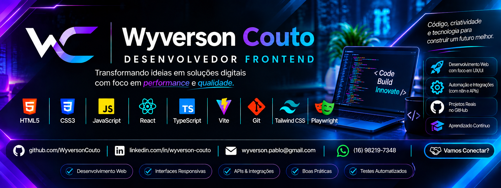

<!-- ========================================================= -->
<!--                GITHUB PROFILE - WYVERSON COUTO            -->
<!-- ========================================================= -->

  

<h1 align="center">Olá 👋, eu sou Wyverson Couto</h1>

  💻 Desenvolvedor Front-end • 🎓 Tecnólogo em ADS • 🚀 Em busca da primeira oportunidade em TI

  
  
  

---

## 👨‍💻 Sobre mim

- 🎓 Tecnólogo em Análise e Desenvolvimento de Sistemas (concluído em 2026)
- 📍 Araraquara - SP • Disponível para trabalho remoto
- 💼 Em transição de carreira para Desenvolvimento de Software
- 🌎 Português (nativo) • Inglês (avançado) • Espanhol (intermediário)
- ⚡ Foco em interfaces responsivas, componentização e integração com APIs REST

---

## 🛠️ Tecnologias

**Front-end**

**Ferramentas e outros**

---

## ⭐ Projeto em destaque

### 🎮 [Kurio — Marketplace de NFTs](https://github.com/WyversonCouto/nft-marketplace-frontend)

Aplicação front-end completa de um marketplace, construída a partir de um layout no Figma e de um desafio técnico: início, detalhe, carrinho, pagamento, confirmação, login, cadastro, perfil e carteiras, em desktop e mobile.

- **Stack:** React, TypeScript, TanStack Router e Query, Axios, Socket.IO, Tailwind CSS, shadcn/ui
- **Qualidade:** MSW para mock de API e tempo real, 72 testes E2E com Playwright e auditoria com Lighthouse
- **Lighthouse (desktop):** Performance 100 • Acessibilidade 97 • Boas práticas 96 • SEO 92
- **Entrega:** deploy público na Vercel e documentação de arquitetura (`ARCHITECTURE.md`)
- 🔗 **[Ver online](https://frontend-challenge-kappa-lac.vercel.app)** • **[Ver código](https://github.com/WyversonCouto/nft-marketplace-frontend)**

---

## 📂 Outros projetos

### 🌐 Front-end

| Projeto | Descrição | Tecnologias | Demo |
|---|---|---|---|
| [**Sistema de Pedidos — Hamburgueria**](https://github.com/WyversonCouto/sistema-pedidos-hamburgueria) | Cardápio digital com carrinho, cálculo automático do total e resumo do pedido em tempo real. Layout responsivo. | HTML, CSS, JavaScript | [Fazer um pedido](https://wyversoncouto.github.io/sistema-pedidos-hamburgueria/) |
| [**Portfólio Profissional**](https://github.com/WyversonCouto/Portfolio) | Site com meus projetos e contatos. | HTML, CSS, JavaScript | [Ver portfólio](https://wyversoncouto.github.io/Portfolio/) |

### 🤖 Automação e IA

| Projeto | Descrição | Tecnologias |
|---|---|---|
| [**WY Assistant AI**](https://github.com/WyversonCouto/WY-Assistant-AI) | Secretária virtual que responde mensagens, gerencia agenda e classifica contatos. Inclui correção de bug de loop de auto-resposta. | n8n, Ollama, Docker, Google Calendar, Gmail, Telegram |
| [**Assistente de Investimentos com RPA e IA**](https://github.com/WyversonCouto/dio-lab-assistente-investimentos-rpa-n8n) | Workflow com IA generativa e envio por e-mail. | n8n, Groq, Gmail |

### 📊 Dados

| Projeto | Descrição | Tecnologias |
|---|---|---|
| [**VoeBem Analytics**](https://github.com/WyversonCouto/voebem-analytics-databricks) | Pipeline de dados da aviação brasileira (ANAC) com arquitetura medalhão: Bronze, Silver, Gold e Genie. | Databricks, SQL, Python |

---

## 📚 Estudando agora

- React e TypeScript (testes, performance e acessibilidade)
- Consumo de APIs REST e gerenciamento de estado de servidor
- Boas práticas: componentização, clean code e Git flow

---

## 🎓 Formação e cursos

- 🎓 **Tecnólogo em Análise e Desenvolvimento de Sistemas** (2026)
- 🚀 **Santander Bootcamp 2026 — Automação com N8N** (DIO, 26h)
- 🧠 **Alura** — Imersão Engenharia de Dados com IA e Imersão Engenharia de Software: Dev na era da IA (com Google for Startups)
- 🐙 **DIO** — Formação GitHub Certification (10h)
- 📘 **Hashtag Treinamentos** — JavaScript, Python e Power BI

---

  💬 Aberto a conversas sobre vagas de <b>Desenvolvedor Front-end Júnior</b> •
  <a href="mailto:wyverson.pablo@gmail.com">Wyverson.pablo@gmail.com</a>

